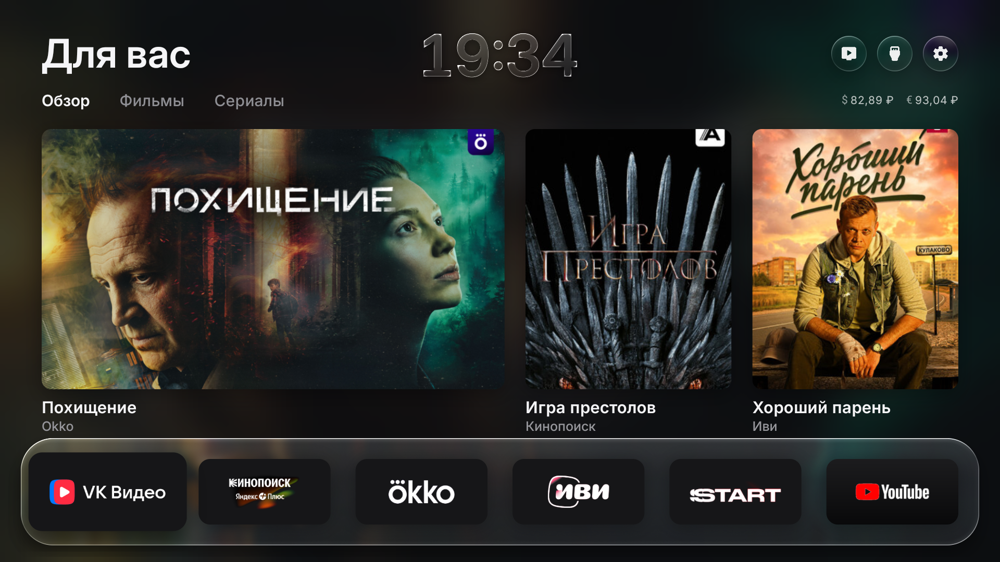
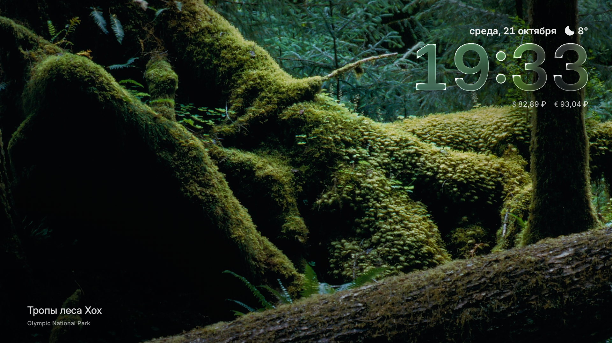

# Free My TV — Haier edition

Адаптация Android TV лаунчера [Free My TV](https://github.com/simbasjungles/free-my-tv) для Haier: стеклянные часы, рекомендации российских кинотеатров и заставка с природой.

Основана на работе **Free My TV contributors**, коммит [`62e883b`](https://github.com/simbasjungles/free-my-tv/commit/62e883b3179c8cafb7a2b09960eabfe7eea6ef1c). Исходная лицензия MIT сохранена. Это самостоятельный репозиторий доработок, без связи с Haier, Apple или кинотеатрами. [Оригинальная документация](README.upstream.md) сохранена отдельно.



## Что изменено

- **Кинопоиск, Okko и Иви:** рекомендации из `TvContract.PreviewPrograms` установленных приложений и переход к соответствующему названию в том же кинотеатре. Данные предоставляет приложение; это не проверка включения фильма в конкретную подписку.
- **Горизонтальный главный баннер 16:9**, дополнительные карточки и увеличенный в 1,35 раза логотип Кинопоиска.
- **Стеклянные часы на главном экране**, обновляющиеся каждую минуту. Тёмная тема выбирается в настройках лаунчера: «Главный экран» → тема «Тёмная».
- **USD/RUB и EUR/RUB** по данным ЦБ РФ вместо криптовалют в Android-версии. Это справочные курсы с датой обновления.
- **Заставка с природой:** шесть встроенных пейзажей, без сети и API-ключа. Новый кадр каждые 30 секунд, переход 3 секунды, медленное движение фотографии и небольшое смещение часов с подписями. Заставка разрешает штатное затемнение Android; таймер отключения экрана не заменяется.
- **Haier:** пустой дополнительный список `DEBLOAT`, сохранён голосовой поиск, обычные каналы и путь возврата к оригинальному экрану. Переключение Home и заставки всё равно меняет активные системные компоненты.
- **Сеть:** ограниченный DNS fallback для API погоды/TMDB с обычной проверкой сертификата и исходного имени узла.



Источники фотографий и авторы: [CREDITS.md](app/assets/gallery/CREDITS.md). Подробности изменений: [CHANGELOG.md](CHANGELOG.md).

## Сборка Android

Нужны **JDK 17+**, Android SDK **build-tools 34.0.0**, **platform android-34**. Gradle и сторонние Java-библиотеки не используются; исходники компилируются с Java 8 language level, minSdk 28, targetSdk 34.

```sh
sdkmanager "build-tools;34.0.0" "platforms;android-34" "platform-tools"
git clone https://github.com/vojoi/free-my-tv-haier.git
cd free-my-tv-haier
```

Скопируйте `config.example.properties` в `config.properties` и укажите город/координаты для погоды. При первом запуске сборка сама создаст этот файл. Пример содержит обычные демонстрационные координаты, без личных данных. Для русских рекомендаций и фотографий заставки TMDB-ключ не нужен.

### Windows / PowerShell

Укажите `JAVA_HOME` и `ANDROID_HOME` либо передайте пути напрямую:

```powershell
./build-windows.ps1 -Public -JdkHome 'C:/Tools/jdk-17' -SdkRoot 'C:/Tools/Android/Sdk'
```

Если переменные окружения уже настроены:

```powershell
./build-windows.ps1 -Public
```

Скрипт также проверяет стандартный Android SDK в `%LOCALAPPDATA%/Android/Sdk` и необязательный соседний каталог `../android-dev`. Инструменты автоматически не скачиваются. Выходной файл — `FreeMyTV-Public.apk`; `-Public` принудительно очищает TMDB-ключ. Без параметра создаётся локальный `FreeMyTV.apk` из вашей конфигурации.

### Linux / macOS

```sh
export JAVA_HOME=/path/to/jdk-17
export ANDROID_HOME=/path/to/android-sdk
./build.sh
```

Выходной файл — `FreeMyTV.apk`. Перед распространением такой сборки убедитесь, что `tmdb_key` в локальном `config.properties` пуст: `build.sh` использует его содержимое. `config.properties`, APK, `out/` и ключи подписи исключены через `.gitignore`.

## Установка и подпись

Разрешите ADB-отладку на своём телевизоре и подключитесь к адресу и порту, показанным в его настройках. При беспроводном сопряжении используйте актуальный код на экране ТВ. Пример с адресом из диапазона документации:

```sh
adb connect 192.0.2.50:5555
adb install FreeMyTV-Public.apk
```

Откройте Free My TV и выберите его в разделе «Главный экран» на самом телевизоре. Перед переключением проверьте, что знаете путь к режиму «Оригинальный». Не отключайте системные компоненты наугад.

**Подпись:** при первой сборке создаётся новый локальный `freemytv.keystore`. Храните его приватно: для обновлений нужен тот же ключ. APK, собранный другим ключом, не может через `adb install -r` заменить уже установленный APK с тем же package name `io.freemytv`. Личный ключ подписи ранее установленной версии в этот репозиторий не входит. Не удаляйте активный Home-лаунчер ради обхода несовпадения подписей: сначала вернитесь к штатному экрану и подготовьте безопасную миграцию.

Разрешение `READ_TV_LISTINGS` может требовать отдельного предоставления на некоторых прошивках. При необходимости:

```sh
adb shell pm grant io.freemytv android.permission.READ_TV_LISTINGS
```

## Проверка и ограничения

Эта адаптация проверена на Haier с Android TV 14: установка обновления, рекомендации и переходы к названиям, часы, системная заставка и выход с пульта. Совместимость с другими моделями и прошивками не гарантируется. Подписки и доступность контента зависят от кинотеатра и региона.

Часть предпочтений хранится на самом телевизоре: тема, город, порядок приложений и разрешения не являются экспортом пользовательского устройства. Настройте их после чистой установки. Никакие личные ключи, параметры подключения к телевизору или диагностические дампы не публикуются.

Каталоги `web/`, `webos/`, `tizen/` и исходный сайт в `docs/` унаследованы от upstream; Android-доработки туда не переносились. Автоматическая публикация исходного сайта через GitHub Pages отключена.

[Участие в разработке](CONTRIBUTING.md) · [MIT License](LICENSE)
